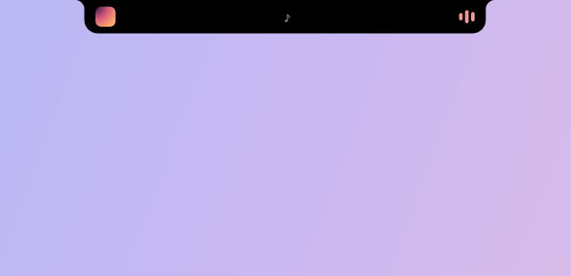

# Isla

Un notch nativo y diminuto para la parte superior de tu pantalla en Windows. Muestra lo
que suena y lo que tu PC quiere contarte. Después se aparta.

[Read in English](README.md)

<p align="center">
  
</p>

- **Lo que suena, de cualquier reproductor.** Spotify, YouTube en cualquier navegador,
  Apple Music y todo lo que aparece en el panel multimedia de Windows. Carátula, título,
  artista, barra de progreso en vivo (clic para adelantar) y anterior / pausa / siguiente.
- **Letras sincronizadas (opcional).** La línea que se está cantando, en la píldora, desde la
  base libre [LRCLIB](https://lrclib.net). En el panel se ven las líneas de alrededor y un
  clic en una salta a ese momento. Apagadas por defecto: es la única función que usa internet.
- **Volumen.** Un control en el panel (clic en el parlante para silenciar), la rueda del
  mouse sobre el notch y un aviso limpio cada vez que cambia el volumen.
- **Avisos del sistema.** Brillo (pantalla de laptop), cambio de salida de audio
  ("AirPods conectados"), cargador conectado o desconectado, batería baja (20 %, 10 %) y
  carga completa.
- **Indicador de micrófono y cámara.** Un punto naranja o verde, como en el teléfono,
  mientras alguna app los usa, y un aviso breve que dice cuál.
- **Pomodoro.** Una tarjeta en el panel; la píldora descuenta los minutos y un sonido
  suave marca el descanso.
- **Recordatorio de agua.** Eliges intervalo, meta diaria y tamaño del vaso. Isla te avisa
  durante el día (de 9:00 a 22:00) y lleva la cuenta de hoy.
- **Pasa el mouse para abrir, aléjalo para cerrar**, o pulsa **Win+Alt+N**. Animación con
  resorte, sincronizada con la frecuencia de tu monitor.
- **A tu manera.** El modo "solo avisos" oculta la píldora hasta que pasa algo, puede
  seguir al monitor de la ventana activa y cada aviso se puede apagar.
- **Se oculta con apps a pantalla completa** (juegos, videos, presentaciones).

## Liviano por diseño

| | Isla 0.3, todo activado |
|---|---|
| Descarga | un `.exe` de ~0,5 MB, sin instalador |
| Memoria | ~10 MB privados; ~14 MB con letras |
| CPU en reposo | 0 %, también con música (letras: un deslizamiento breve por línea) |
| Dependencias | ninguna; Windows 10 1809+ o Windows 11, 64 bits |

- **Win32 nativo + Direct2D**, escrito en Rust. Sin motor web, sin .NET, sin Electron.
- **Espera en vez de consultar.** Windows avisa cuando cambia la canción, se mueve el
  volumen, se conecta el cargador o una app abre el micrófono. Entre eventos el proceso
  duerme.
- **Dibuja solo cuando algo se mueve**, a partir de vistas cacheadas en bitmaps.
- **Sin driver de GPU en el proceso:** dibuja con WARP y Windows compone en la GPU, así
  la GPU dedicada de una laptop no se despierta.
- **Sin hooks de teclado ni mouse, sin telemetría y sin red salvo que actives las letras.**
  El atajo Win+Alt+N es una tecla rápida registrada: Windows solo informa esa combinación.

## Instalación

1. Descarga `isla.exe` desde el [último release](../../releases/latest).
2. Opcional: verifica que su SHA-256 coincida con `isla.exe.sha256` del mismo release:
   ```powershell
   Get-FileHash .\isla.exe -Algorithm SHA256
   ```
3. Ejecútalo. SmartScreen puede advertir de un editor desconocido porque el exe es nuevo
   y no está firmado: **Más información → Ejecutar de todas formas**. GitHub Actions lo
   compila desde este repositorio, así que puedes verificar exactamente lo que corres.

Clic derecho en el icono de la bandeja para los ajustes: iniciar con Windows, avisos,
letras sincronizadas y su sincronía, intervalo del recordatorio, meta diaria, tamaño del
vaso, Pomodoro o salir. Los ajustes se guardan en
`%APPDATA%\Isla\settings.ini`.

Para desinstalar: desmarca "Iniciar con Windows" si lo activaste, sal desde la bandeja y
borra el exe y `%APPDATA%\Isla`.

## Privacidad

Isla lee la sesión multimedia que Windows ya expone (título, artista, carátula) y el estado
de energía. Tu registro de agua queda en tu carpeta.

De fábrica, Isla no se conecta a internet. Si activas las **letras sincronizadas**, envía
a [lrclib.net](https://lrclib.net) el título, el artista, el álbum y la duración de cada
canción nueva para buscar su letra, y nada más: ni identificadores ni cookies. Las letras
quedan solo en memoria. Con las letras apagadas, Isla ni siquiera carga las bibliotecas de
red de Windows.

## Compilar

```powershell
cargo build --release   # target\release\isla.exe
```

Ver [CONTRIBUTING.md](CONTRIBUTING.md).

## Licencia

[MIT](LICENSE)
